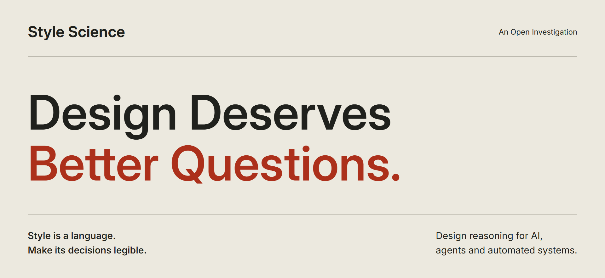

<a href="https://jongos.github.io/style-science/#manifesto">
  <picture>
    <source media="(max-width: 600px)" srcset="docs/assets/readme-mobile.png">
    
  </picture>
</a>

# Style Science

**Give Design Decisions a Reason.**

Style Science connects design requirements to measurable checks. Teams and agents can use its JavaScript and Python tools to compare alternatives, inspect results and revise decisions.

Its Generative Design Canvas (GDC) checks declared requirements against captured observations and reports **pass, fail or unknown** for design review.

## Put It to Work

- **Make a brief actionable.** Turn “make it clearer” into requirements such as visible pricing, readable contrast and no mobile overflow.
- **Compare alternatives honestly.** Keep benefits, costs and missing evidence visible rather than hiding them in one score.
- **Check an agent’s output.** Test declared constraints before carrying a candidate forward for design review.
- **Share the reasoning.** Keep requirements and evidence understandable across a team and its tools.

## Try the Core

Use Style Science through its JavaScript or Python toolkit. From a checkout, with Node.js 22+:

```sh
node --input-type=module -e "import { contrast } from './engine.mjs'; console.log(contrast('#000000', '#ffffff'));"
```

Start with the [example requirement plan](examples/plan.json), then follow the [integration guide](REFERENCE.md#try-it) for JavaScript, Python and rendered observations.

[Read the manifesto](https://jongos.github.io/style-science/) · [Explore the interactive study](https://jongos.github.io/style-science/#design-study) · [Research foundations](REFERENCE.md#contextual-decisions-and-research)

## In the Hex Men Family

| Project | How It Complements This Work |
|---|---|
| [Dazzler](https://github.com/jongos/Dazzler) | Create and refine interfaces, documents and slides. |
| [Longshot](https://github.com/jongos/Longshot) | Test interface tasks and report reproducible findings. |
| [Spiral](https://github.com/jongos/Spiral) | Find gaps in workflow handoffs, ownership and recovery. |
| [Shatterstar](https://github.com/jongos/Shatterstar) | Simplify products while preserving important tasks. |
| [Mojo](https://github.com/jongos/Mojo) | Make AI outputs clear and direct. |

[Explore Hex Men](https://github.com/jongos/Hex-Men) for tools that complement your task.

## Further Reading

[Detailed project reference](REFERENCE.md) · [License and credits](REFERENCE.md#license-and-credits)
